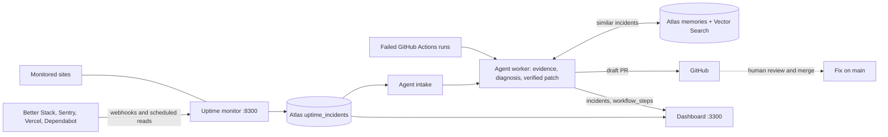

# OpsRelay: system architecture

This document describes the code in this repository as of 2026-11-25: how an incident is detected,
investigated by the repair agent and handed to a person. Solid arrows are implemented calls; dashed
arrows are manual (human) steps.

## Components

| Component | Port | Code | State |
| --- | --- | --- | --- |
| OpsRelay uptime API + monitor | 8300 | `admin-dashboard/backend/uptime` | Atlas `uptime_*`, or SQLite locally |
| OpsRelay dashboard | 3300 | `admin-dashboard/web` | reads the uptime API |
| Agent worker | | `agents/orchestrator.py` | Atlas `incidents`, `workflow_steps`, `memories` |

`./dev.sh` starts all of them. The agent worker needs `MONGODB_URI` (Atlas).

## End-to-end map

## 1. Detection

The uptime monitor checks each workspace's sites: the page, an optional health URL and, when a service
declares one, a functional probe that reports which business checks failed and a source hint. A failing
check opens one incident per service in `uptime_incidents`; repeated failures update it, and the first
passing check resolves it. Unreachable services take the `service_health` route; a failing functional
probe on a reachable service takes `investigate`. Alerts from Better Stack, Sentry, Vercel and Dependabot
open incidents the same way (see below). CI status is extra evidence when GitHub is configured.

## 2. Agent investigation

The agent worker polls failed GitHub Actions runs and, through `agents/intake.py`, new open uptime
incidents. Each becomes one record in `incidents` and runs through the same stages:
`detected` -> `memory_retrieved` -> `patch_verified` -> `pr_intent_saved` -> `pr_confirmed` ->
`memory_saved`. Each stage is a fenced write under a lease, so a crashed worker's incident is picked up
by the next one without repeating a completed stage, and a PR whose response was lost is found again
instead of opened twice.

For a live incident, `agents/live_repair.py` gathers the failing probe checks, the deployed commit's
recent diff, the source files under the app's repair scope (`agents/apps.toml`), CI status and similar
past incidents from Atlas Vector Search. The result carries one `recommendation`:

| Action | When |
| --- | --- |
| `propose_code_fix` | The diagnosis is a code bug, the agent reproduced it (existing suite or a new regression test fails at the deployed commit) and the patch passes the tests. |
| `operational_step` | A service-health problem or a third-party outage: no model call or code change is made. |
| `ask_for_review` | Anything else: the evidence does not support one action. |

A verified patch follows the workflow: save the PR intent in Atlas, open a **draft PR**, and wait. A
human reviews and merges. The agent never merges. Repositories without an `apps.toml` entry still get a
diagnosis, but no verified patch or PR.

## Accounts and workspaces

The dashboard needs a sign-in (email and password; the session is an HttpOnly cookie). Every data route
reads one workspace, and the API returns 404 for a workspace, service or incident the account does not
own. Each workspace adds the sites it monitors under **Sites** (a page URL and an optional health URL); a
GitHub Actions schedule calls `POST /api/v1/cron/check` every 5 minutes to check every workspace's sites.
The first account to sign up claims the `demo` workspace; later accounts create their own.

Under **Connectors**, a workspace connects GitHub with a token (stored server-side, never returned) and
creates its Better Stack webhook. Under **Repositories** it maps a repository the token can access to a service: base branch, deployed URL and an optional workflow check.
The API checks the branch and workflow exist on GitHub before saving the mapping.

**Better Stack alerts.** Each workspace gets its own webhook URL plus a secret that Better Stack sends as
the `X-OpsRelay-Secret` header (Better Stack doesn't sign webhooks). The payload's monitor id picks the
mapped service. One Better Stack incident is one OpsRelay incident: an exact redelivery is ignored, and
acknowledged, resolved and reopened events update that same incident.

**Sentry issues.** A workspace creates a webhook URL under **Connectors**, adds it to a Sentry internal
integration with `issue` webhooks, and saves that integration's client secret; every delivery must carry
`Sentry-Hook-Signature` (HMAC-SHA256 of the raw body with that secret). Each mapped service names its
Sentry project slug. Issues created or unresolved join the repository's open set, resolved or ignored
ones leave it, and the set drives one incident per repository (`uptime/rollup.py`, shared with Dependabot):
degraded, or down if any issue is fatal, resolved when the set is empty. A redelivery changes nothing.

**Vercel deployments.** A workspace saves a Vercel token (and a team id for team projects) under
**Connectors**; each mapped service names its Vercel project. The scheduled check reads the project's
latest production deployment: `ERROR` opens the repository's Vercel rollup incident (degraded, since the
previous deployment keeps serving), the next `READY` one resolves it, and a deployment still building
changes nothing.

**Open pull requests and issues.** The scheduled check also reads each mapped repository's open pull
requests and issues (drafts left out, so the agent's own draft PRs don't count) into one backlog incident
per repository (`uptime/backlog.py`, the same rollup), resolved once nothing is open. A repository added
with unmerged version bumps or old issues therefore gets an incident at once, and diagnose mode
investigates it. Facts the dashboard computes come first and are marked as reliable: mergeable state,
age, major or minor upgrade, changed files that no longer exist on the base branch, and checks that
fail on the base branch too. Then, as untrusted data, the PR's description, its diff (lockfiles
skipped), its check runs and commit statuses, and the error lines of a failing Actions check. For an
issue: its text, comments and the PRs and commits that mention it. The model gives every item it was
shown one verdict (merge, change or close, with the reason), and the incident page shows the verdict
next to each item.

**Notifications.** Under **Connectors**, a workspace can add outgoing connectors: Slack and Discord
incoming webhooks, a generic webhook (JSON signed with `X-OpsRelay-Signature: sha256=<HMAC of the body>`,
its secret shown once, every request through the private-URL guard) and PagerDuty (Events API v2:
trigger on open, resolve on close, deduplicated by incident). The scheduled check derives events from stored state: an incident opened or
resolved, the repair agent opening a draft PR, or handing an incident to a human. Each
(connector, incident, event) is claimed once in storage before it is sent, and a failed send releases
the claim, so a repeated run never double-posts and a failure is retried. Events from before a connector
was saved are skipped. Webhook URLs are secrets: only their last characters are returned.

**Repair agent per repository.** Each mapped repository has an agent switch (off by default) and a mode:
report only (default; the agent investigates and records a recommendation, no PR) or draft PRs. The shared
Python worker's live intake picks up a Better Stack incident only when its repository's agent is on, and
only for the repository that worker is configured for (`GITHUB_OWNER`/`GITHUB_REPO`), using the code area
chosen from `agents/apps.toml`. It then runs the same Atlas-backed stages as a monitor incident.

## Durable state in Atlas

| Collection | Owner | Holds |
| --- | --- | --- |
| `uptime_incidents`, `uptime_*` | uptime monitor | incidents, checks, service state |
| `opsrelay_users`, `opsrelay_emails`, `opsrelay_sessions`, `opsrelay_workspaces` | uptime API | dashboard accounts, hashed session tokens, workspaces; `opsrelay_github`, `opsrelay_repos`: GitHub connections and repository mappings; `opsrelay_bs_*`, `opsrelay_alert_*`: Better Stack webhooks, monitor mappings, delivery dedupe |
| `incidents`, `workflow_steps` | agent orchestrator | repair stage machine, PR intent, recommendation, audit trail |
| `memories` | agent orchestrator | past fixes for Vector Search |

## Code map

- Monitor and incidents: `admin-dashboard/backend/uptime/worker.py`, `incidents.py`, `probes.py`, `storage/`
- Alerts and rollups: `admin-dashboard/backend/uptime/alerts.py`, `sentry.py`, `vercel.py`, `dependabot.py`, `backlog.py`, `rollup.py`
- Agent intake and stages: `agents/intake.py`, `agents/orchestrator.py`, `agents/mongodb.py`
- Investigation and repair: `agents/live_repair.py`, `agents/investigator.py`, `agents/patcher.py`, `agents/verifier.py`
- PR publishing: `agents/github_publisher.py`
- Dashboard: `admin-dashboard/web/src/app/incidents/[id]/page.tsx`, `src/app/ai-agent/[incidentId]/page.tsx`
